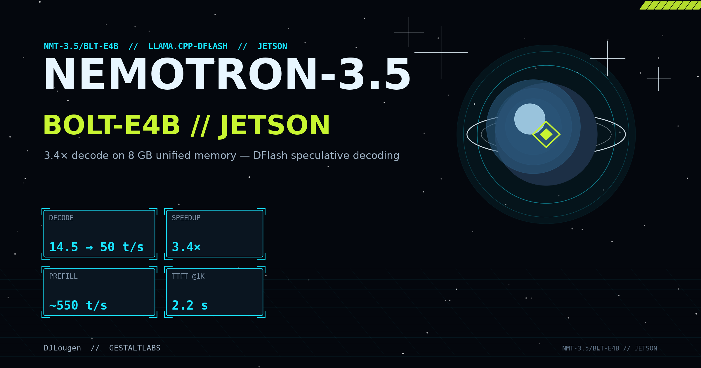
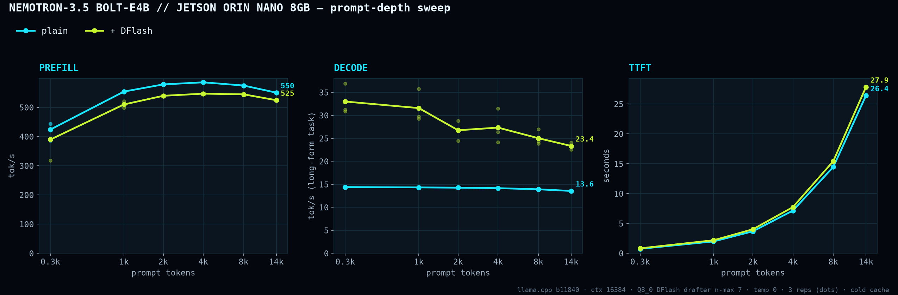
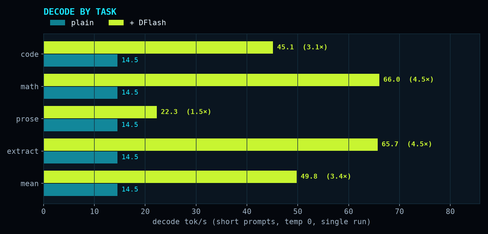
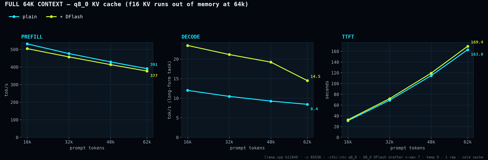
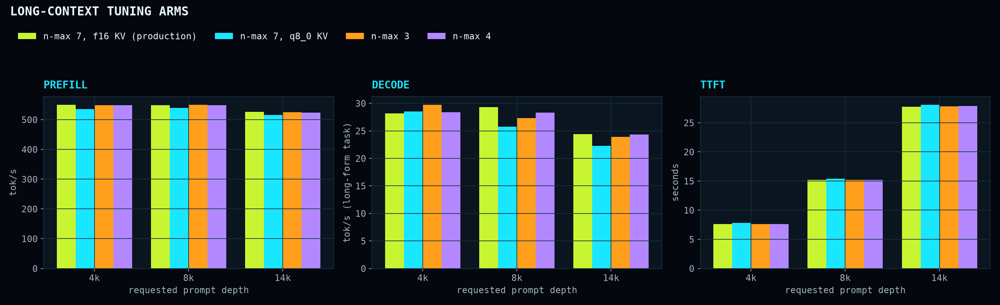

# Nemotron-3.5-Bolt-E4B on Jetson Orin Nano 8GB: 3.4× decode with DFlash





A complete recipe for running [nvidia/NVIDIA-Nemotron-3.5-Bolt-E4B-4GB](https://huggingface.co/nvidia/NVIDIA-Nemotron-3.5-Bolt-E4B-4GB)
(Q4_K_M GGUF) with its [DFlash speculative-decoding drafter](https://huggingface.co/nvidia/NVIDIA-Nemotron-3.5-Bolt-E4B-4GB-DFlash)
on an **8 GB Jetson Orin Nano Super**, using llama.cpp b11840 with a Q8_0-quantized drafter at ctx 16384.

| | plain | + DFlash |
|---|---|---|
| decode, short prompts (mean of 4 tasks) | 14.5 tok/s | **49.8 tok/s (3.4×)** |
| decode, long-form task @ 0.3k / 14k prompt | 14.4 / 13.6 | **33.0 / 23.4** |
| prefill @ 4k prompt | 586 tok/s | 547 tok/s |
| TTFT @ 1k / 4k / 14k prompt | 2.0 / 7.2 / 26.4 s | 2.2 / 7.7 / 27.9 s |
| **full 64k context** (q8_0 KV), decode @ 16k / 62k | 12.0 / 8.4 tok/s | **23.5 / 14.5 tok/s (1.7×)** |
| TTFT @ 62k prompt (cold) | 163 s | 169 s |

- DFlash prefill runs 5–8% below plain. The cause hasn't been isolated.
- Math, JSON and code reach 45–66 tok/s, measured on short (~100-token) prompts.
- Memory: about 1.3 GiB free with the service loaded (ctx 16k, f16 KV).
- **The full 64k context needs `-c 65536 -ctk q8_0 -ctv q8_0`.** With f16 KV it runs out of memory at startup, and q8_0 leaves about 780 MiB free. DFlash keeps a 1.7–2× decode lead across the whole range. A cold 62k-token prompt takes about 2.8 minutes before the first token.

Scripts in [`scripts/`](scripts/), systemd unit in [`systemd/`](systemd/), all raw
numbers in [`results/`](results/).

## Why DFlash and not a generic draft model

On a bandwidth-bound unified-memory device, a generic small draft model *costs*
16–41% throughput — the draft steals bandwidth and rejected drafts are pure waste.
DFlash is different: it's a 360M drafter that reuses **hidden states from five layers
of the target model** (layers 6/12/18/24/36), proposes 7-token blocks, and needs no
second KV cache walk. Measured acceptance: 4.4–6.5 of 7 tokens on code/math/JSON,
~2.1 on prose.

## What you need

- Jetson Orin Nano Super 8GB (or similar 8 GB unified-memory aarch64 board), JetPack 7.x, CUDA 13.x
- ~7 GB disk for the target GGUF + ~0.7 GB drafter
- llama.cpp **≥ b11840** (gemma4 + dflash support)

## 1. Build llama.cpp

```bash
git clone https://github.com/ggml-org/llama.cpp ~/llama.cpp-bolt
cd ~/llama.cpp-bolt && git fetch origin tag b11840 && git checkout b11840
cmake -B build-cuda -DGGML_CUDA=ON -DCMAKE_CUDA_ARCHITECTURES=87 \
      -DGGML_NATIVE=ON -DLLAMA_CURL=OFF -DCMAKE_BUILD_TYPE=Release
cmake --build build-cuda -j4 --target llama-server llama-cli llama-quantize
```

(-j4 fits in 7.4 GB; higher parallelism OOMs nvcc on 6-core Orin.)

## 2. Download the files

```bash
hf download nvidia/NVIDIA-Nemotron-3.5-Bolt-E4B-4GB \
   Nemotron-3.5-Bolt-E4B-Q4_K_M.gguf --local-dir ~/models/bolt
hf download nvidia/NVIDIA-Nemotron-3.5-Bolt-E4B-4GB-DFlash \
   Nemotron-3.5-Bolt-E4B-DFlash-BF16.gguf --local-dir ~/models/bolt
```

## 3. Quantize the drafter (saves 280 MiB, identical acceptance)

```bash
~/llama.cpp-bolt/build-cuda/bin/llama-quantize \
  ~/models/bolt/Nemotron-3.5-Bolt-E4B-DFlash-BF16.gguf \
  ~/models/bolt/Nemotron-3.5-Bolt-E4B-DFlash-Q8_0.gguf Q8_0
```

## 4. Serve

Edit `scripts/bolt-serve.sh` to point `M=` at your model dir, then:

```bash
BOLT_CTX=16384 BOLT_DRAFT=Nemotron-3.5-Bolt-E4B-DFlash-Q8_0.gguf \
  scripts/bolt-serve.sh dflash
# plain baseline: scripts/bolt-serve.sh plain
```

**The two flags that make-or-break 8 GB unified memory:**

- `-lm mmap -lzm on` — the model carries a 2.79 GiB per-layer token-embedding
  table. With llama.cpp defaults that table loads into anonymous RAM and the KV
  cache cudaMalloc OOMs. `mmap` + lazy row reads keep it file-backed and on-demand.
- `GGML_CUDA_NO_PINNED=1` — pinned staging buffers fragment nvmap on Orin.

Test:

```bash
curl -s localhost:8000/v1/chat/completions -H 'Content-Type: application/json' \
  -d '{"model":"nemotron-bolt","messages":[{"role":"user","content":"What is 17 × 23?"}],"max_tokens":256}'
```

## 5. Run as a service

Copy `systemd/bolt-llm.service` to `/etc/systemd/system/`, adjust paths/user, then:

```bash
sudo systemctl daemon-reload && sudo systemctl enable --now bolt-llm
```

The unit sets `OOMScoreAdjust=900` — if RAM runs out, the LLM is killed before
the rest of the system. It binds `127.0.0.1` (plus a tailnet IP if you add one);
**don't expose an unauthenticated LLM to your LAN.**

## 6. Measure it yourself

```bash
# decode on 4 short prompt types (server running in dflash or plain mode)
python3 scripts/bolt_bench.py http://127.0.0.1:8000 myrun 256

# prompt-depth sweep, one run per arm (LLAMA_CPP_DIR supplies the public text corpus)
scripts/bolt-serve.sh dflash &   # wait for /health
python3 scripts/depth_sweep.py --out results/depth_dflash.json --label dflash-q8d
kill %1; scripts/bolt-serve.sh plain &
python3 scripts/depth_sweep.py --out results/depth_plain.json --label plain
kill %1

python3 scripts/make_graphs.py   # -> assets/overview_v3.png, assets/decode_by_task_v3.png
```

## Results

Measured on Jetson Orin Nano Super (MAXN_SUPER, GPU 1020 MHz, JetPack 7.2,
CUDA 13.2), llama.cpp b11840, single runs at temp 0, thinking off, ctx 16384,
Q8_0 drafter with n-max 7; depth curves are means of 3 reps.
Raw data: [`results/`](results/), charts regenerable via `scripts/make_graphs.py`.

**Caveats we verified so you don't have to:**

- DFlash acceptance is task-dependent: 6.5/7 on math/JSON, 2.1/7 on free-form
  prose — prose gets ~1.5×, structured output ~4.5×.
- Greedy output can differ from plain decoding (llama.cpp
  [#25618](https://github.com/ggml-org/llama.cpp/issues/25618)); identical on
  code/math/JSON here, different on prose.
- The 2.79 GiB per-layer embedding table lives on SSD, read on demand — resident
  memory is ~6.2 GiB with 16k ctx.

## Long-context tuning



Every arm used prompts of 4k, 8k and 14k tokens, 2 reps each, with the Q8_0 drafter at ctx 16384:

- **Draft length 7 / 4 / 3:** within noise of each other at depth (24.4 / 24.4 / 23.9 tok/s at 14k). Keep 7, because it wins clearly on short prompts.
- **q8_0 KV cache:** no gain. 22.3 vs 24.4 tok/s at 14k, prefill 2% lower, TTFT 0.4 s worse.
- **Larger prefill batch (`-ub 1024` / `2048`):** doesn't fit. Gemma-4's 262k-token vocabulary makes the compute buffer 2.1 GB at ub 1024, so 1024 and above run out of memory on 8 GB. 768 hasn't been tested.
- **What limits long context:** prefill tops out around 550 tok/s, so a 14k prompt costs about 27 s cold. In a chat, llama-server's prompt caching (on by default) should mean later turns only process the new tokens. That is expected behaviour, not measured here.

## Tuning knobs

| knob | effect | set via |
|---|---|---|
| draft length | 7 > 4 > 2 (50.0 / 40.2 / 30.3 tok/s mean) | `BOLT_NMAX` |
| context | 16384 default; 32768 measured at full speed with f16 KV (591 MiB free) | `BOLT_CTX` |
| KV dtype | q8_0 saves ~350 MiB; decode cost and long-prompt limits **not settled** — f16 is the safe default | extra args `-ctk q8_0 -ctv q8_0` |
| drafter | Q8_0 ≡ BF16 (token-identical acceptance) | `BOLT_DRAFT` |

## Troubleshooting

- **`cudaMalloc failed: out of memory` at load** → you're missing `-lm mmap -lzm on`.
- **`dflash requires ctx_other` warning** → harmless, appears during memory fit.
- **Server dies after a reboot** → check `journalctl -u bolt-llm`; if the bind
  address is a tailnet IP, ensure `After=tailscaled.service` and that
  `RestartSec` ≥ 10s so StartLimit never trips.
- **OOM killer took a NAS service** → confirm `OOMScoreAdjust=900` in the unit.

## Credits & license

- Model: [nvidia/NVIDIA-Nemotron-3.5-Bolt-E4B-4GB](https://huggingface.co/nvidia/NVIDIA-Nemotron-3.5-Bolt-E4B-4GB),
  OpenMDW-1.1, Gemma-4 E4B (Apache-2.0) base — weights are NOT redistributed here.
- llama.cpp: ggml-org, MIT.
- Scripts in this repo: MIT — see [LICENSE](LICENSE).
